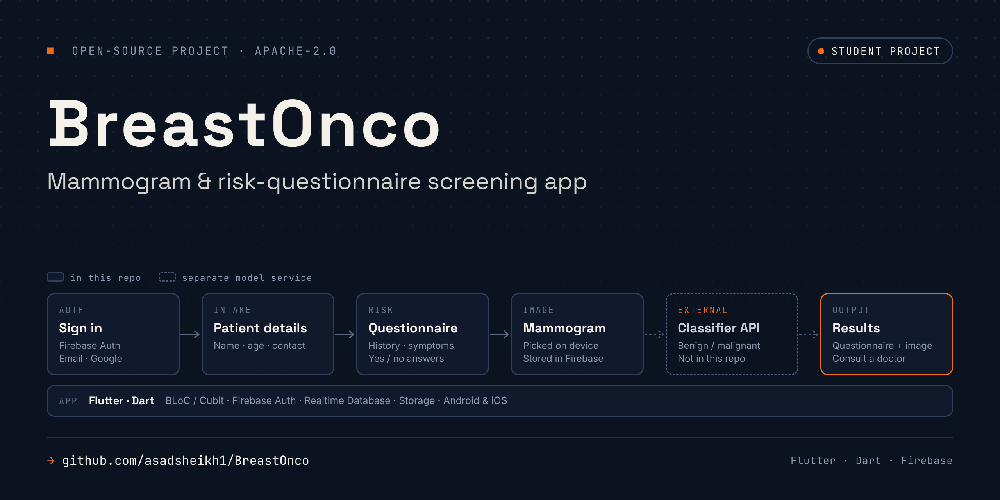

<p align="center">
  
</p>

# BreastOnco

**A Flutter app for breast-cancer screening: patients answer a risk questionnaire and upload a mammogram, and the app shows a benign / malignant result for each, with a prompt to consult a medical professional.**

Student project · Flutter · Firebase · Android & iOS

> ⚠️ **Not a medical device.** BreastOnco is an academic project and must not be used for diagnosis.

## Screens


## How it works

1. **Sign in.** Firebase Authentication (email and Google sign-in).
2. **Patient details.** Name, age and contact details for the person being screened.
3. **Risk questionnaire.** Yes / no questions on family history, prior conditions, lifestyle and current symptoms.
4. **Mammogram.** The image is picked from the device gallery and uploaded to Firebase Storage.
5. **Prediction.** The app calls a classifier API (base URL in `lib/constants/api.dart`) for a questionnaire result and a mammogram result.
6. **Results.** Both results are saved with the patient record in Firebase Realtime Database and shown on the results screen.

**About the model:** this repository contains the mobile app only. The classifier runs as a separate service and is not included here; in this code, `fetchData()` returns a stub label from `modelClassifier()` so the app flow can be demonstrated without the model service.

## Tech stack

| Layer | Tools |
|---|---|
| App | Flutter, Dart, BLoC / Cubit (`flutter_bloc`) |
| Auth & data | Firebase Authentication, Google Sign-In, Firebase Realtime Database, Firebase Storage |
| Device | `image_picker` (gallery upload) |
| Platforms | Android, iOS (plus Flutter desktop / web scaffolding) |

## Project structure

```
lib/
  screens/     sign-in / sign-up, patient details, questionnaire, image upload, results
  widgets/     reusable UI pieces (question tiles, patient info, progress indicators)
  constants/   questionnaire, API base URL, Firebase repository helpers
  themes/      colours, text styles, theme cubit
  routes/      named routes
```

## Run it locally

Prerequisites: [Flutter](https://docs.flutter.dev/get-started/install) (Dart SDK ≥ 3.2.3) and a Firebase project of your own.

```bash
git clone https://github.com/asadsheikh1/BreastOnco.git
cd BreastOnco
flutter pub get
# Point the app at your Firebase project (regenerates lib/firebase_options.dart)
dart pub global activate flutterfire_cli
flutterfire configure
flutter run
```

To use a real classifier, serve it from an HTTP endpoint and set the base URL in `lib/constants/api.dart`.

## Licence

[Apache-2.0](LICENSE) · Built by [Asad Sheikh](https://github.com/asadsheikh1) · [LinkedIn](https://www.linkedin.com/in/asadsheikh1/)
